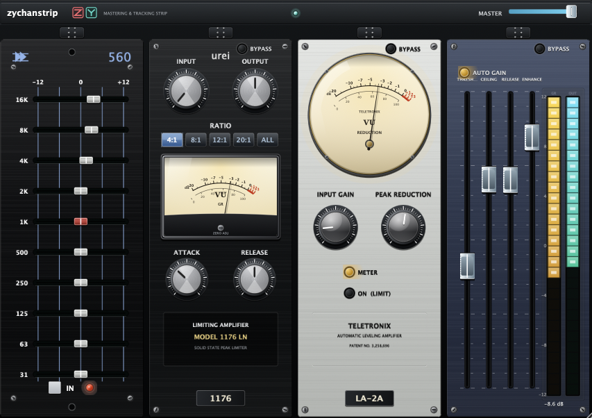

<p align="center">
  
</p>

# zychanstrip

### The Ultimate Analog Mastering & Tracking Rack for macOS

[-blue.svg)](#build-and-install)
[-orange.svg)](#build-and-install)
[](#architecture)
[](#architecture)

**zychanstrip** is four classic outboard processors in one rack plus a Studio-Grade metering page, delivered as a high-performance **Audio Unit (AU)** effect.

Two pages live side by side, switched by the **RACK / METER** toggle in the header:

- **RACK** — four re-orderable hardware faceplates: API 560 graphic EQ, UREI 1176 FET compressor, Teletronix LA-2A opto leveler, and an Enhance/master limiter with parallel dry/wet.
- **METER** — an SSL-style analyser page: dual true-peak/RMS meters, Lissajous phase scope, correlation bar and a 31-band real-time analyser.

---

## Contents

- [Quick start for a new agent](#quick-start-for-a-new-agent)
- [Architecture](#architecture)
- [The Four Modules](#the-four-modules)
- [The Metering Page](#the-metering-page)
- [Signal Flow, Latency and Phase](#signal-flow-latency-and-phase)
- [Parameters](#parameters)
- [Build and Install](#build-and-install)
- [Development & Verification Tools](#development--verification-tools)
- [Known issues / next work](#known-issues--next-work)
- [Conventions & traps](#conventions--traps)

---

## Quick start for a new agent

Read this before touching code. It is the fastest route from a fresh clone to a working build.

```bash
git clone https://git.zyusof.net/zack/rackstrip.git
cd rackstrip

# CMake and Ninja are usually installed by pip on this machine, not in PATH by default:
export PATH="$HOME/Library/Python/3.13/bin:$PATH"

cmake -S . -B build -G Ninja -DCMAKE_BUILD_TYPE=Release
ninja -C build                       # builds AND installs the AU (COPY_PLUGIN_AFTER_BUILD)
```

Verify:

```bash
python3 tools/build_snapshot.py      # builds the headless GUI/DSP harness (reuses Ninja flags)
./build/snapshot/snapshot /tmp/shots # runs all tests, writes PNGs
# expect: RESULT 230/230 passed
```

**Where the code lives**

| Concern | File(s) |
| --- | --- |
| DSP for all four modules | `Source/Modules.h` |
| API 560 EQ core (MIT, adapted) | `Source/Eq560.h` |
| Processor, parameter tree, dry/wet mix, metering tap | `Source/PluginProcessor.{h,cpp}` |
| Metering measurement (FFT, peaks, correlation, LUFS) | `Source/Meters.h` |
| Meter page drawing/behaviour | `Source/MeterPanel.{h,cpp}` |
| Rack UI, panels, LookAndFeel, page switch | `Source/PluginEditor.{h,cpp}` |
| Headless test + snapshot harness | `tools/snapshot_main.cpp`, `tools/dsp_checks.h`, `tools/build_snapshot.py` |

**Before you change anything**

1. `git pull` — work from the latest `main`, not a stale copy.
2. Run the harness first and confirm 230/230 so you know your baseline.
3. After ANY change: `ninja -C build` then re-run the harness. The build auto-installs,
   so a passing harness means the installed plugin is the code you just wrote.
4. Commit and push.

---

## Architecture

**Plugin shell.** `RackStripProcessor` is an `AudioProcessor` with a fixed four-slot rack. It is not a synth, needs no MIDI, and presents AU type `aufx`, subtype `Zych`, manufacturer `ZYUS` (`net.zyusof.zychanstrip`).

**Module model.** Every module derives from `rack::Module` (`Source/Modules.h`) and exposes `process(AudioBuffer&)`, plus `getLatencySamples()`, an atomic `grDb` for its meter, and (limiter only) `outPeak` / `gainCompDb`. Modules are processed **in rack order**, which is stored as a single packed `uint32_t` that the audio thread reads once per block — re-ordering can never tear mid-block.

```cpp
enum ModuleId { Console = 0, Opto = 1, Fet = 2, Limiter = 3, NumModules = 4 };
// slot i holds module id byte i of packedOrder; default 0x03010200 => [0,2,1,3]
```

**Parameters.** A single `AudioProcessorValueTreeState` with **41** parameters (see [Parameters](#parameters)). Adding one is a one-line `addF`/`addB` call in `createLayout()`; **never reorder or re-range an existing ID** — host automation and saved sessions depend on them. New parameters must be appended at the end.

**State migration.** `setStateInformation` patches older session blobs by inserting any parameter that is missing (e.g. `lim_auto_gain`, the EQ560 bands, `master_mix`). If you add a parameter, add it to that migration list too, or old sessions will silently miss it.

**Editor.** `RackStripEditor` holds a `canvas` component that draws the chassis and hosts the four `ModulePanel` children plus the header controls. A second child, `MeterPanel`, fills the window when the METER page is selected.

---

## The Four Modules

### 1. API 560 10-band graphic EQ (`Console`, prefix `con_`)
Proportional-Q bands at 16k, 8k, 4k, 2k, 1k, 500, 250, 125, 63, 31 Hz, ±12 dB, with 2× oversampling and 2520-style op-amp / 2503-transformer saturation. Ten extra legacy 4-band controls remain registered for automation compatibility but are inactive.

### 2. UREI 1176 LN FET compressor (`Fet`, prefix `fet_`)
Input/output/attack/release plus a 4:1 / 8:1 / 12:1 / 20:1 / ALL ratio bank. Fast attack, fixed threshold driven by input gain, Class-A FET colour.

### 3. Teletronix LA-2A opto leveler (`Opto`, prefix `opto_`)
Gain, peak reduction, and a compress/limit `mode` switch. Program-dependent release, 12AX7/12BH7 tube colour.

### 4. Enhance / master limiter (`Limiter`, prefix `lim_`)
Look-ahead brickwall limiter with tape/console saturation (`lim_enhance`), and a stereo-linked auto-gain that matches its own output level back to its input so you hear tone changes rather than loudness shifts.

Its four fader channels (threshold, ceiling, release, enhance) are recessed black slots drawn with a very thin white rim (`RackLookAndFeel::drawChromeFader`), so the black slider lines stay readable against the dark plate.

**Default rack order is 560 → 1176 → LA-2A → Enhance** (`[0,2,1,3]`). Any saved session keeps its own order — the default only applies to fresh instances.

### RESET
`RESET` in the header (and `RESET` on the metering page) restores the factory state in one action:

* every parameter returns to the default declared in `createLayout()` — module controls, master level and dry/wet mix alike;
* the rack order returns to `[0,2,1,3]` and the faceplates animate back to those slots;
* all metering (peaks, holds, RTA, scope, correlation) is cleared.

Both RESET pills, and the metering page `BACK`, share one look (`Source/UiStyle.h`): the RACK/METER teal gradient at rest and matte black while held, so the momentary action visibly bottoms out.

* the rack order returns to `[0,2,1,3]` and the faceplates animate back to those slots;
* all metering (peaks, holds, RTA, scope, correlation) is cleared.

Parameter values are written on the message thread with real gestures, so host automation follows the reset. Module DSP state (EQ biquads, compressor envelopes, limiter delay and energy rings) is cleared at the start of the next audio block via a single atomic request, so the reset is real-time safe and leaves no stale look-ahead tail. `RackStripProcessor::resetToDefaults()` is the one implementation; both buttons call it through `RackStripEditor::resetRackToDefaults()`.

### Parallel dry/wet
`master_mix` (0–100 %, default 100) blends the untouched input against the finished master output for parallel processing. It is applied **after** master volume.

---

## The Metering Page

Selected with the header **RACK / METER** toggle; the METER page has its own **`< RACK`** button to return, so the way back is always present.

**It is a pure analyser.** It observes the signal after the master gain and after the dry/wet mix, and never modifies audio. All numbers come from `RackMeters` (`Source/Meters.h`), which publishes measurements through atomics from the audio thread and is read by the UI at 30 Hz. Nothing on this page is simulated.

| Measurement | Implementation |
| --- | --- |
| Peak | per-channel sample peak per block |
| Max-hold | 2 s hold then slow release |
| RMS | ~300 ms smoothed block RMS |
| Short-term loudness | K-weighted (2nd-order HP ~38 Hz + shelf) over a 400 ms window, shown in LUFS |
| Correlation | block-wise L/R correlation, −1…+1 |
| Phase scope | decimated L/R pairs rotated 45° into a Lissajous |
| 31-band analyser | 2048-point FFT, Hann window, folded into 31 log-spaced bands with per-band peak-hold |

**Hooks:** `RackStripEditor::timerCallback()` calls `MeterPanel::tick()` only while the meter page is visible; `RackStripEditor::showPage(bool)` swaps pages.

---

## Signal Flow, Latency and Phase

```
Host input
   │
   ├── copy to dryBuffer (untouched, for parallel mix)
   │
   ▼
slot 0 → slot 1 → slot 2 → slot 3     (any permutation, atomic per block)
   │
   ▼
master gain  (master_level, −60…+6 dB)
   │
   ▼
dry/wet blend (master_mix)
   │
   ▼
metering tap (read-only)
   │
   ▼
Host output
```

**Latency.** Only the limiter adds latency: `la = ceil(0.0015 · sr)` with reported latency `la − 1` — **71 samples ≈ 1.48 ms at 48 kHz**. It is reported to the host and is constant regardless of module order or bypass, so the rack never drifts against parallel tracks.

**Phase.** The limiter is latency-compensated internally (its own `dryDelay` ring aligns its auto-gain measurement). **The dry/wet mix is currently NOT compensated** — see [Known issues](#known-issues--next-work).

---

## Parameters

41 automated parameters. `bypass` is `false` = module active.

| Module | Prefix | Parameters |
| --- | --- | --- |
| Console | `con_` | `bypass`, `eq_16k`, `eq_8k`, `eq_4k`, `eq_2k`, `eq_1k`, `eq_500`, `eq_250`, `eq_125`, `eq_63`, `eq_31`, `hpf`, `lf`, `lmf_f`, `lmf`, `hmf_f`, `hmf`, `hf`, `thresh`, `ratio`, `attack`, `release`, `out` |
| Opto | `opto_` | `bypass`, `gain`, `peak`, `mode` |
| FET | `fet_` | `bypass`, `input`, `output`, `attack`, `release`, `ratio` |
| Limiter | `lim_` | `bypass`, `gain`, `ceiling`, `release`, `enhance`, `auto_gain` |
| Master | — | `master_level`, `master_mix` |

**Interaction.** Every knob, fader and slider supports mouse-wheel scrolling; hold ⇧ for fine steps; double-click restores the default.

---

## Build and Install

**Requirements (verified on this machine):** macOS with Xcode Command Line Tools (`xcode-select --install`), CMake ≥ 3.22, Ninja, Apple Silicon (arm64 target is forced in `CMakeLists.txt`). JUCE 8.0.4 is fetched automatically by `FetchContent` into `build/_deps/juce-src` on first configure.

```bash
export PATH="$HOME/Library/Python/3.13/bin:$PATH"   # pip-installed cmake/ninja
cmake -S . -B build -G Ninja -DCMAKE_BUILD_TYPE=Release
ninja -C build
```

`COPY_PLUGIN_AFTER_BUILD` is on, so a successful build installs to:

```
~/Library/Audio/Plug-Ins/Components/zychanstrip.component
```

To also install system-wide (both locations work; the system copy wins):

```bash
/usr/bin/ditto ~/Library/Audio/Plug-Ins/Components/zychanstrip.component \
                   /Library/Audio/Plug-Ins/Components/zychanstrip.component
```

> **Note:** installing to BOTH locations is a known source of confusion — the AU registrar sees two copies of the same subtype. Prefer one. Tracked as `rackstrip-dupe-au`.

**Build directory gotcha.** `build/` is configured against an absolute source path. If you move or rename the repo, `ninja` fails with `rebuilding 'build.ninja': subcommand failed`. Fix: `rm -rf build` and re-run `cmake -S . -B build ...` from the new path.

---

## Development & Verification Tools

### Headless harness

`tools/build_snapshot.py` compiles `tools/snapshot_main.cpp` against the same objects Ninja produced, so it exercises exactly the shipped code — no separate build to drift out of sync.

```bash
python3 tools/build_snapshot.py
./build/snapshot/snapshot <output-dir>
```

It runs **230 checks** and writes PNGs to `<output-dir>`:

- **DSP** (`tools/dsp_checks.h`): EQ band response, limiter behaviour, auto-gain, channel handling, master gain ramp, state roundtrip, legacy-session migration, dry/wet mix law.
- **GUI**: page toggle clicks (real `mouseDown`, not a test seam), BACK from the meter page, control containment inside every panel at 864×608 / 1080×760 / 1620×1140, reorder by grip drag, aspect-ratio lock.
- **Snapshots**: `rack-*.png` and `meter-*.png`; the meter ones are rendered with real audio pushed through the chain so the meters, scope and analyser show genuine values.

**When you add a feature, add a check.** A test that only asserts "it did something" is how real bugs ship: the dry/wet phase inversion and the auto-gain order dependence both passed the suite as originally written.

### Teardown check (important)

The harness does **not** exercise editor destruction, which is where crashes live. Use this pattern manually when touching UI lifecycle:

```cpp
auto* ed = static_cast<RackStripEditor*>(proc.createEditor());
ed->setSize (1080, 760);
delete ed;                    // any slider/attachment ordering bug fires here
```

---

## Known issues / next work

| ID | Issue | Detail |
| --- | --- | --- |
| `rackstrip-mix-phase` | **Dry/wet has a phase error** | The dry copy is not delayed to match the wet path's 71 samples. At 50 % mix a 1 kHz tone cancels by ~24 dB (measured RMS 0.023 vs 0.353). Fix: delay the dry copy by the reported latency before summing. |
| `rackstrip-autogain-order` | **Auto-gain is order-dependent** | It measures inside the limiter, so it cannot see upstream gain: the same settings give 0.691 vs 0.289 RMS depending on whether the limiter is last or first (7.6 dB spread), while the correction only moves 0.3 dB. Fix: measure chain input vs final output in `processBlock` and share one compensated reference with the mix. |
| `rackstrip-verify-quit-crash` | Unverified crash fix | A crash at app quit (`MessageQueue::post` on a null mutex) was hardened in `fb3cb3f` but never reproduced locally. Awaiting repro steps. |
| `rackstrip-rta-averaging` | RTA averaging is cosmetic | The label changes but the FFT smoothing factor is hard-coded (`0.28` in `Meters.h`). |
| `rackstrip-vu-ppm` | Missing panel | The spec's analog VU/PPM pair with needle ballistics is not built. |
| `rackstrip-dupe-au` | Duplicate AU install | Same component in `~/Library` and `/Library`. |

Closed work is recorded with evidence; anything unverified stays open deliberately.

---

## Conventions & traps

1. **Latest release is the base.** Branch from the newest tag/`main`, never a stale local copy.
2. **Never change existing parameter IDs, ranges or defaults.** Append only. Preserve the state migration path.
3. **Editor lifecycle.** Declare `Slider`s **before** the `SliderParameterAttachment`s that reference them — members are destroyed in reverse, and the wrong order calls `removeListener()` on freed memory (`EXC_BAD_ACCESS`, fixed in `ef1aa29`).
4. **Component naming.** Setting a name in a constructor can be lost when the component is added; set it at registration if anything looks it up by name.
5. **Click handling.** The rack `canvas` covers the whole editor and consumes clicks; editor-level `mouseDown` will not fire for anything drawn into the canvas. Add a child component instead (as the page toggle does).
6. **Draw order.** `ModulePanel::paint` draws the face image, then `paintMeter`, then composites the caption layer on top. Anything that must sit *behind* a live meter belongs in the face image (`paintFaceBase`), not the caption layer.
7. **Repaint hygiene.** Meter ticks run at 30 Hz; only repaint while `isShowing()`. A timer firing during teardown can post into a dying message queue.
8. **Bitmaps are banned.** All graphics are procedural `juce::Graphics` calls so the UI stays sharp at any scale (864×608 → 1620×1140, 27:19 locked).

### Repo conventions
- Remote: `https://git.zyusof.net/zack/rackstrip` (Gitea). `main` is the trunk.
- Commit and push every change; verify with `git status` and `git log --oneline origin/main..HEAD` (empty = pushed).
- Keep the harness green before pushing.
