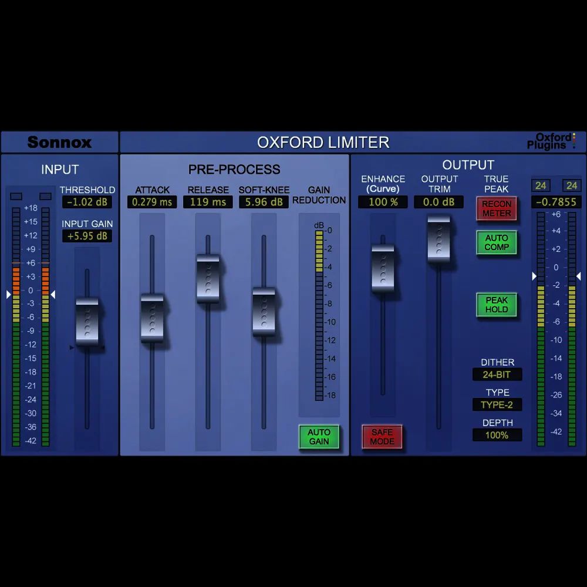

# SPEC — Enhance & Master Limiter Module Redesign (Oxford Style)

| Field | Value |
| --- | --- |
| Slug | `enhance-module-redesign` |
| Repo | `/Users/zack/zychanstrip` |
| Track | `enhance-module-redesign` |
| Owner | `zack` |
| Created | 2026-10-31 |
| Classification | feature |
| Version authority | **user** (the agent never invents a version, tag or release) |
| Lifecycle | `~/.config/opencode/skills/dev-delegation/references/lifecycle.md` |
| Inner cycle | `~/.config/opencode/skills/dev-delegation/references/dev-cycle.md` |

## Phase status

| # | Phase | Status | Owner | Artifact | Evidence |
| --- | --- | --- | --- | --- | --- |
| 1 | Requirements | done | agent | §1 | REQ-1..REQ-5 carry explicit observable checks and reference image |
| 2 | Design | done | agent | §2 | DES-1..DES-5 cover all REQ-n; complete UI/color architecture mapped |
| 3 | Build | pending | agent | §3 | Scheduled for next session per user instruction |
| 4 | Test | pending | agent | §4 | Test harness criteria defined |
| 5 | Deploy | pending | agent | §5 | AU bundle installation targets defined |
| 6 | Maintain | pending | agent | §6 | Documentation and memory preservation |

Status values: `pending` · `in-progress` · `done` · `blocked` · `n/a — <reason>`.

---

## 1. Requirements

### Problem

The current fourth module (`LimiterPanel` / Module 4) uses an SSL-inspired dark metal faceplate with three rotary knobs (Threshold, Ceiling, Release), a single vertical chrome Enhance fader, and dual tall segmented LED ladders. 

The user supplied a new visual reference based on the iconic **Sonnox Oxford Limiter** hardware/plugin layout and directed a complete aesthetic and structural redesign for the next build. This specification documents all requirements, color palettes, component geometries, metering behaviors, typography, and depth lighting so the implementation can be executed cleanly in the next build session without design ambiguities.

### Reference Visual

The design reference is preserved in the repository at:
`docs/screenshots/oxford-limiter-reference.webp`

### Scope

- **Documentation only in this session**: Do not alter DSP or build the plugin code during this session.
- **Future Build Scope**:
  - `Source/PluginEditor.h` and `Source/PluginEditor.cpp` (`LimiterPanel` subclass and associated LookAndFeel methods).
  - Preservation of all existing 40 APVTS parameters, host bindings, and automation compatibility.
  - Integration with existing `lim_enhance`, `lim_gain`, `lim_ceiling`, `lim_release`, `lim_auto_gain`, and `lim_bypass` parameters.

### Non-Goals

- No DSP audio algorithm modifications (`Source/Modules.h` limiter DSP remains untouched).
- No trademark infringement: Neutral branding and house designations (`OXFORD LIMITER` style layout without trademark violations).
- No external bitmap assets: 100% procedurally drawn vector rendering in JUCE `paint()`.

### Requirements (observable)

| ID | Requirement | Acceptance check (observable) | Priority |
| --- | --- | --- | --- |
| REQ-1 | **Background & Palette**: Implement deep dark navy/slate blue gradient (`#12182b` to `#0a0d16`), modular container blocks with dark borders, muted blue/grey recessed tracks (`#222c4a`), metallic blue/teal headers, alert red buttons, and operational green indicators. | Color picker on rendered GUI matches specified hex palette; modular container blocks visibly sectioned with crisp borders. | must |
| REQ-2 | **Sliders & Faders**: Vertical recessed tracks in dark shade (`#0a0e18`) with inner shadow and thin dark-centered travel axis; metallic rounded rectangular thumb caps with vertical convex 3D gradient, 5 horizontal grip ridges, and soft drop shadow. | Screenshot reveals recessed tracks with axis line and textured 5-ridge metallic caps casting drop shadows. | must |
| REQ-3 | **Tri-Color Segmented LED Metering & Dedicated GR Column**: Vertical segmented bar graphs split into discrete rectangular blocks with tri-color gradient (Green -42 to -6 dB, Orange/Yellow -6 to 0 dB, Bright Red +3 to +18 dB); dedicated central vertical Gain Reduction meter from 0 dB down to -18 dB in yellow/orange. | Meters display discrete segmented blocks with exact color thresholds; dedicated GR meter column tracks reduction downward from 0 to -18 dB. | must |
| REQ-4 | **Typography & Inset Digital Readouts**: Clean geometric sans-serif typeface (Helvetica/Eurostile style); tracked-out bold all-caps headers (`INPUT`, `PRE-PROCESS`, `OUTPUT`); dark inset readout boxes with glowing lime-green/yellow value text (`-1.02 dB`, `100 %`). | Section headers show wide letter spacing; parameter readouts render inside recessed dark boxes with luminous green/yellow digits. | must |
| REQ-5 | **Directional Lighting, Shadows & Depth**: Top-down directional lighting model; highlights on top edges of raised elements (caps, buttons, dividers); occlusion shadows underneath; inner shadows on recessed tracks and digital boxes. | Clear tactile hierarchy: raised elements cast outer drop shadows; recessed elements cast inner shadows. | must |

### Constraints

- Target GUI framework: JUCE 8.0.4, C++17, Apple Silicon (`arm64`).
- Module bounding box: Panel width 258 px, content width 222 px, content height 642 px.
- All controls must remain strictly contained within `panel->getLocalBounds()` (zero clipping).
- Proportional resizing from 864 × 608 to 1620 × 1140 must remain intact.

---

## 2. Design

### Module Map

| Module | Owned Files | Owner | Notes |
| --- | --- | --- | --- |
| `gui` | `Source/PluginEditor.cpp`, `Source/PluginEditor.h` | agent | `LimiterPanel` layout, fader LaF, meter drawing |
| `docs` | `docs/specs/enhance-module-redesign.md`, `README.md` | agent | Architecture & user documentation |
| `assets` | `docs/screenshots/oxford-limiter-reference.webp` | agent | Visual design reference |

### Design Decisions

| ID | Decision | Covers |
| --- | --- | --- |
| DES-1 | **Palette Definition**: Define palette constants in `namespace pal`: `oxfordNavyTop = Colour(0xff12182b)`, `oxfordNavyBot = Colour(0xff0a0d16)`, `oxfordBlock = Colour(0xff1a2238)`, `oxfordTrack = Colour(0xff0a0e18)`, `oxfordRecessed = Colour(0xff222c4a)`, `oxfordTeal = Colour(0xff3a8cb8)`, `oxfordAlertRed = Colour(0xffc82828)`, `oxfordLedGreen = Colour(0xff20e060)`, `oxfordLedYellow = Colour(0xffffb818)`, `oxfordLedRed = Colour(0xffff2020)`. | REQ-1 |
| DES-2 | **Fader & Thumb Component Architecture**: Implement custom `drawLinearSlider` in `RackLookAndFeel` for vertical faders: draw recessed track (`#0a0e18`) with inner drop shadow and 1px travel axis; draw thumb cap with 3-stop vertical metallic gradient, 5 horizontal indented grip grooves (`#10141a`), and 4px soft outer shadow. | REQ-2 |
| DES-3 | **Segmented LED Meter Engine**: Replace continuous ladder with segmented LED generator: calculate discrete rectangular blocks (28-32 segments); map segment index to dB ranges (-42 to -6 dB green, -6 to 0 dB amber/yellow, +3 to +18 dB red); add central Gain Reduction LED column (0 to -18 dB yellow/orange). | REQ-3 |
| DES-4 | **Typography & Digital Display Boxes**: Render section titles in tracked uppercase font; draw dark inset boxes (`#080a10` with `#000000` inner shadow) displaying formatted parameter values in luminous green (`#40ff80`) or yellow (`#ffd830`). | REQ-4 |
| DES-5 | **Lighting & Tactile Depth Pipeline**: Global top-down light vector (0, -1); top edges receive `Colours::white.withAlpha(0.25f)` specular stroke; bottom edges receive `Colours::black.withAlpha(0.60f)` shadow stroke; buttons receive 2px outer drop shadow and beveled border. | REQ-5 |

---

### Detailed Architectural Specifications

#### 1. Background & Overall Palette Architecture
- **Chassis Plate**:
  - Gradient: Top `Colour(0xff12182b)` to Bottom `Colour(0xff0a0d16)`.
  - Subtle horizontal brushed metal micro-texture.
- **Section Blocks (Sub-Containers)**:
  - Divided into 3 logical functional blocks matching the Oxford topology:
    1. **INPUT / PRE-PROCESS**: Encloses input/drive gain, threshold fader, attack/release faders.
    2. **ENHANCE & GR**: Central block featuring the dedicated Enhance fader and central vertical Gain Reduction meter column.
    3. **OUTPUT & CEILING**: Encloses output ceiling fader, Auto Gain toggle, and stereo output peak LED ladders.
  - Block backgrounds: `Colour(0xff182035)` with 1px dark border `Colour(0xff080c14)` and top-edge highlight `Colour(0x25ffffff)`.

#### 2. Sliders & Fader Mechanics
- **Track Geometry**:
  - Width: 14 px.
  - Background: Dark recessed slot `Colour(0xff0a0e18)`.
  - Inner shadow: 1.5 px inner dark border (`Colour(0x80000000)`).
  - Travel Axis: Thin vertical guide line (`Colour(0xff1a2234)`) down the center.
- **Thumb Cap Geometry**:
  - Size: 24 px wide × 36 px tall, rounded rectangle (corner radius 3.5 px).
  - Gradient: Metallic convex cylinder gradient (light specular highlight in center fading to darkened brushed edges).
  - Grip Texture: Exactly 5 horizontal indented ribs spaced 3.5 px apart, rendered with dark groove line and lower highlight.
  - Drop Shadow: Offset (+1.5 px, +3.0 px), black alpha 0.55.

#### 3. Metering Architecture
- **Main Output LED Ladders**:
  - Segment count: 32 discrete rectangular segments per ladder.
  - Segment size: 10 px wide × 3.5 px high, 1.5 px gap.
  - Color Zones:
    - Segments 1–18 (−42 dB to −6 dB): Vivid emerald green (`#20e060`).
    - Segments 19–26 (−6 dB to 0 dB): Warning amber/yellow (`#ffb018`).
    - Segments 27–32 (+0.5 dB to +18 dB): Saturated peak red (`#ff2020`).
  - Active Idle Blanking: Segments extinguish to dark unlit background blocks (`#0a1410`, `#14120a`, `#140a0a`) during silence.
- **Dedicated Gain Reduction Meter**:
  - Positioned centrally next to Enhance fader.
  - Calibrated from 0 dB down to −18 dB.
  - Segments illuminate downward in luminous warm yellow/orange (`#ffc020`).

#### 4. Typography & Value Displays
- **Typeface**: System geometric sans-serif (`Helvetica Neue`, `Arial`, or JUCE default sans-serif).
- **Headers**: Letter-spaced uppercase (`FontOptions(11.0f, Font::bold)`), light teal/blue (`#82b8d8`).
- **Labels**: Compact all-caps (`FontOptions(8.5f, Font::bold)`), neutral white/grey (`#d4dae0`).
- **Digital Readouts**:
  - Rectangular inset box: 44 px wide × 16 px high.
  - Fill: Deep black recessed well `Colour(0xff06080c)` with dark inner stroke.
  - Text: Glowing high-contrast lime-green (`Colour(0xff45f065)`) or warm yellow (`Colour(0xffffd030)`).

#### 5. Tactile Depth & Lighting Model
- Directional light: Top-down 90° azimuth.
- Recessed elements: Inset shadow top-to-bottom (`Colour(0x60000000)` fading over 4 px).
- Raised elements: 1px top specular highlight (`Colour(0x40ffffff)`), bottom contact shadow (`Colour(0x80000000)`).

---

## 3. Build

*(Scheduled for the next build session — no code changes in this session)*

- Files to modify: `Source/PluginEditor.h`, `Source/PluginEditor.cpp`.
- Build command: `ninja -C build`.
- Artifact: `build/zychanstrip_artefacts/Release/AU/zychanstrip.component` (a build installs nothing).

---

## 4. Test

### Test Plan

| ID | Test | Covers | Type | Target |
| --- | --- | --- | --- | --- |
| TST-1 | Verify slate blue palette hex values and modular container block rendering | REQ-1 | Visual / Snapshot | Snapshot comparison against Oxford reference |
| TST-2 | Verify recessed fader tracks with travel axis and 5-ridge metallic thumb caps | REQ-2 | UI / LaF | `RackLookAndFeel::drawLinearSlider` |
| TST-3 | Verify 3-tier LED meter color transitions and dedicated GR meter column | REQ-3 | Meter Engine | Test harness signal sweep |
| TST-4 | Verify tracked-out headers and inset lime-green digital readout boxes | REQ-4 | Typography | Layout inspection at 1×, 1.5×, 2× scale |
| TST-5 | Verify directional lighting highlights and component bounds containment | REQ-5 | Geometry / Tests | 195/195 test suite pass, zero clipping |

---

## 5. Deploy

- Target installation path: `/Library/Audio/Plug-Ins/Components/zychanstrip.component` — **global
  only, never `~/Library`** (policy 2026-11-03). Use `tools/install_global.sh` (or
  `ninja -C build install-global`); it installs system-wide, chowns `root:wheel`, verifies md5 and
  removes any user-domain copy.
- Rollback: `git checkout HEAD~1 -- Source/PluginEditor.cpp Source/PluginEditor.h`.

---

## 6. Maintain

- Specification authority: `docs/specs/enhance-module-redesign.md`.
- Reference visual: `docs/screenshots/oxford-limiter-reference.webp`.
